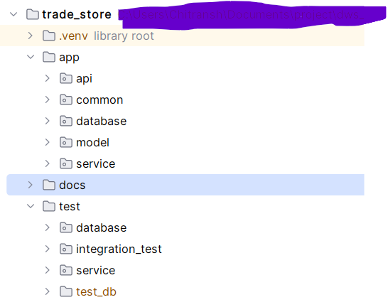
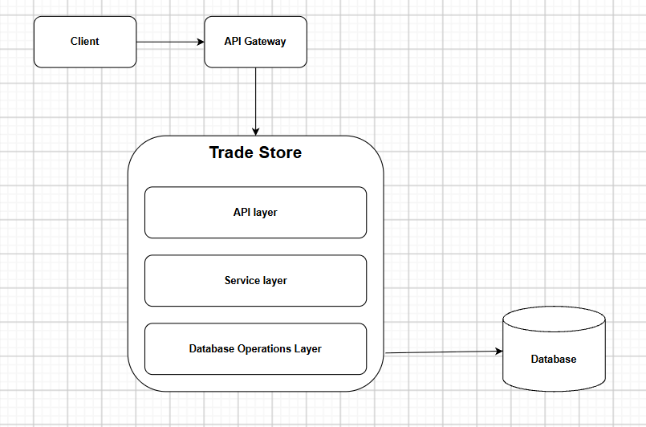
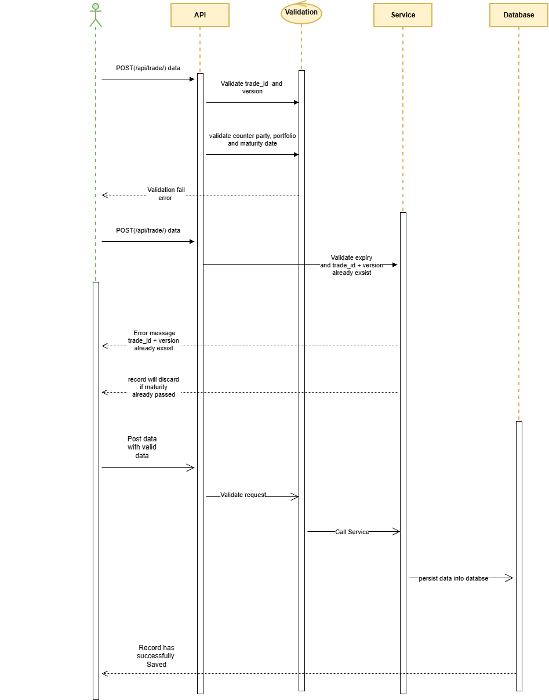

# Trade Store REST API 
A small trade-store service implementing version-aware upserts, maturity-date validation, automatic expiration refresh, automated tests, and GitHub Actions CI.
# Business rules
+ trade_id and version uniquely identifies a trade.
+ An incoming lower version is rejected if higher version is already saved.
+ The same version and trade_id will replace saved data with new data sets.
+ A trade with a maturity_date earlier than the current local date is rejected
+ A trade is marked expired="Y" when its maturity date is strictly earlier than today's date.
+ Expired is managed by the cron job.
# Project Structure

# Prerequisite
+ Python 3.14
+ GitBash
+ Docker Desktop (optional)
+ After git clone project add .env file in root folder of project and below values - 
  + TABLE_NAME=trader_trans
  + DB_PATH=./data/dws.db
  + DB_TIMEOUT=10
# How run application

### Run Test-Cases & Integration Tests locally
uv run python -m pytest

### Run Application locally
uv run uvicorn app.api.trade_app:app --reload

### Docker command to create Image and Container
docker build -t trade-store:1.0 .

docker volume create trade-store-data

To start application in docker container, run below command from terminal or powershell -
docker run -d `
  --name trade-store-api `
  -p 8000:8000 `
  -e DB_PATH=/data/dws.db `
  -e DB_TIMEOUT=10 `
  -v trade-store-data:/data `
  trade-store:1.0

# API Example

curl -X 'POST' \
  'http://localhost:8000/api/trade' \
  -H 'accept: */*' \
  -H 'Content-Type: application/json' \
  -d '{
  "trade_id": "TEST_3",
  "version": 3,
  "counter_party_id": "DWS BANK",
  "portfolio_id": "B1",
  "maturity_date": "12/12/2026"
}'

### Response
{
  "status": "success",
  "message": "Trade added successfully",
  "rowid": 3
}

# High Level Design

# Sequence Diagram

